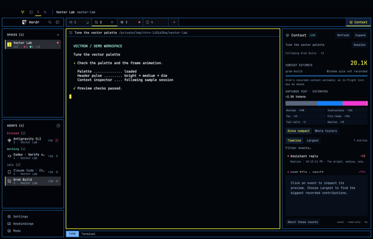

# Herdr Vectron

Vectron is a layout for Herdr with dark, boxed panels, a bright vector palette, and three-stage flashes on interaction. The Context panel follows the selected local Codex, Claude Code, Grok Build, or Antigravity CLI session.

## Install

Give your agent this instruction in Herdr.

> Read ~/.config/herdr-app/AGENTS.md, then add the layout from https://github.com/no-complect/herdr-vectron using RECIPE.md.

For a manual install, copy the files from [layouts](layouts), the [mod folders](mods) containing a main.js, and [themes/vectron.json](themes/vectron.json) into their matching directories under ~/.config/herdr-app. Keep the existing files when names collide. Merge the two sections in [keys.json](keys.json) into your own keys.json. Then select **Vectron** in Herdr or run this command.

    herdr-app do layout.switch '{"name":"vectron"}'

Tested with stock Herdr 0.1.16 on macOS. The Context panel requires Python 3 and reads local agent session files. Its reported counts and estimates are labeled separately. Files and Changes run filesystem and Git commands in the selected workspace. The optional browser tools use Herdr Browser if installed. The usage panel reads supported login files and contacts the matching Claude, ChatGPT, or Copilot usage service when a corresponding agent is visible. The Mods screen and Git graph can query GitHub.

## Controls

In Context’s live **Since compact** view, a recorded Codex or Claude compaction can shrink the captured-text bar. The previous extent fades out as the panel shows the estimates before and after.

| Control | Action |
| --- | --- |
| ⌘P | Find a tab, space, or agent |
| ⌘⇧P | Search commands |
| ⌘1–9 and Ctrl+1–9 | Select a space or agent |
| Shift+F2 or right-click a space → Rename | Rename a space |
| **+** in the tab bar | Start an agent. Type to filter the list. |
| Agents header → branch icon or ⌘⇧P → Agent map | See parent agents and workers in the current space. Click a node to peek at its terminal. |
| Files, Changes, Context | Select the right-hand panel from the tab bar |
| Context → Categories | Show the full category legend and filter by category |
| Context → Select an event | Open its preview |
| Context → Count details | See the model, window size, and how the counts were calculated |
| Context → Expand | Open the larger inspector |
| **History** in a focused terminal header | Return to live output. The header pulses when the terminal reaches the bottom. |

The pane header flashes when a terminal gains focus or its selected agent starts working. The Context panel pulses when its captured counts update. Space renaming and agent filtering use the command palette's typing flash.

In the Agent map, a pulse travels toward a worker when it first needs input. Its outline stays highlighted while it waits.

Edge Alerts in the top bar pulse when a background agent needs input or finishes. The markers show how many agents are waiting or finished. Click a marker to open the most recently changed agent in that group.

Moving between panes or tabs leaves a short, fading trace on the two most recently departed headers within that tab or space.

## Development

Run `npm test` with Node.js 22 or later and Python 3.10 or later. The suites in
[mods/test](mods/test) and [themes/test](themes/test) use sample workspaces and
transcripts. Run `npm run test:herdr` with `herdr-app` on your PATH to load every
mod in Herdr's native checker.

Keep imports inside each mod's folder so Herdr can load it independently. Group
related statements with blank lines between steps, and document why a decision
or a compatibility constraint exists.

## Credits

- The workspace layout and navigation mods build on [Tuuxic](https://github.com/Tuuxic/herdr-tuuxic) and bundle [Whistle](https://github.com/Tuuxic/herdr-whistle).
- The Context panel adapts [Herdr Context Facey](https://github.com/no-complect/herdr-context-facey). The tabs and pane header adapt code from [Herdr App](https://github.com/herdrdev/herdr-app).
- Changes adapts [Herdr Git Graph](https://github.com/rabeeh-ta/herdr-git-graph), with repository discovery based on [Manygit](https://github.com/rabeeh-ta/manygit). Mod Manager is based on [herdr-plugin-manager](https://github.com/speardragon/herdr-plugin-manager).
- Files and Changes use [Charmed Icons](https://github.com/littensy/charmed-icons). The interface includes [Lucide](https://lucide.dev) icons.

See [LICENSES](LICENSES) and the license notices in the bundled mod folders.
