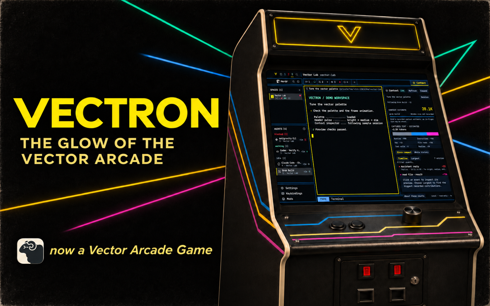

# Vectron

Vectron brings the glow and playful timing of classic stand-up vector arcades to Herdr. Switch agents and the environment pulses, flashes, and lights up like the classic games of old. Live context bars pulse as you work in Codex, Claude Code, Grok Build, or Gemini Antigravity.

## What you see

- The 30 px top bar holds the Vectron mark, sidebar toggle, space numbers, picker, current space and folder, and an AI usage area. Native window buttons occupy the platform’s usual position.
- The left column stacks the header, Spaces, Agents, and Settings, Keybindings, and Mods buttons. Collapsing it keeps an icon rail.
- The middle column has a 36 px tab strip above the terminal. Each terminal has a 30 px header, a square 2 px frame and 12 px text padding. The Whistle bar sits beneath the terminal area.
- The right-hand stack is 349 px wide initially and can show Files, Changes, Context, or Browser Notes. Context shows the selected agent’s latest recorded input or context estimate, an estimated captured-text breakdown, and a filterable event list.

## How it behaves

- Pick a space, agent, or tab with a click or its layout shortcut. Pane headers flash when the terminal gains focus and when the selected agent starts working. The three peaks fade in order and use slightly varied spacing.
- Edge Alerts in the top bar count background agents that need input or have finished. The markers pulse on new activity. Click one to open the most recently changed agent in that group.
- Working agents show a spinner. Blocked agents use an alert color, and finished agents get a status mark until viewed. The sidebar responds to selection. Command search, the picker, and the Context filter pulse when their input changes.
- The Agents list, tabs, and pane headers use Vectron glyphs for Codex, Grok Build, Antigravity CLI, and Claude Code. Each glyph follows the three flashes of its row, tab, or header, changing hue at each peak. Other programs use their Herdr icons.
- Context follows the focused supported local agent. The panel can expand, filter events, and switch between Timeline and Largest or since-compaction and whole-history views. Categories opens the full legend. Select an event to open its preview. Count details explains the reported and estimated counts.
- On macOS, ⌘P opens the picker and ⌘⇧P opens the command palette. The layout also supplies Ctrl+Shift+K and Ctrl+Shift+P for the dialog variants. Whistle’s settings enable its optional keyboard navigation.

## Built from

- [layouts/vectron.json](layouts/vectron.json) defines the chrome nodes and the terminal pane frame. [themes/vectron.json](themes/vectron.json) supplies Vectron's palette for both appearances.
- The bar, chrome, Spaces, Agents, Tabs, and Pane mods draw the frame and navigation. The two picker and two palette variants retain their popup and dialog sizes. The icon folder provides assets they share.
- The Agent map opens from the Agents header or command palette and shows parent and worker links in the current space.
- Files, Changes, Context, and Browser Notes implement the side stack. Context invokes its bundled read-only Python reader. The Mods, Settings, Themes, and Keybindings overlays keep the original controls accessible.
- Copy the [mod folders](mods) containing a main.js, including Whistle and the icon folder. The layout uses Herdr’s bundled menu, prompt, worktree dialog, and stock artwork. Merge [keys.json](keys.json) by section and keep unrelated bindings.

## Watch out

- Install the layout preview alongside the layout JSON and copy the Vectron theme into themes/. Themes opens a preview of Vectron and lets you apply it.
- Context uses Python 3 and local session files. Its fallback lets you choose a session when an exact match is unavailable. The usage panel may read local provider login files and fetch usage from the corresponding provider. Files, Changes, and the Mods screen also run commands or access files as needed. Browser Notes expects the optional Herdr Browser helper.
- The header pulse uses focus and agent status events available in stock Herdr. This package uses the stock terminal frame.
- Reopen restores the saved pane arrangement. Matching a prior agent process to its session uses Linux process metadata. On macOS the reopened panes start shells.

## Done when

- Stock Herdr loads **Vectron** and reports no errors. The primary theme and Context panel appear on a fresh install.
- Switch panes and start work in the selected agent. The selected pane header flashes in each case.
- The command palette, picker, Settings, Keybindings, Mods, and Themes open with their shortcuts. Files, Changes, and Context switch from the tab bar.
